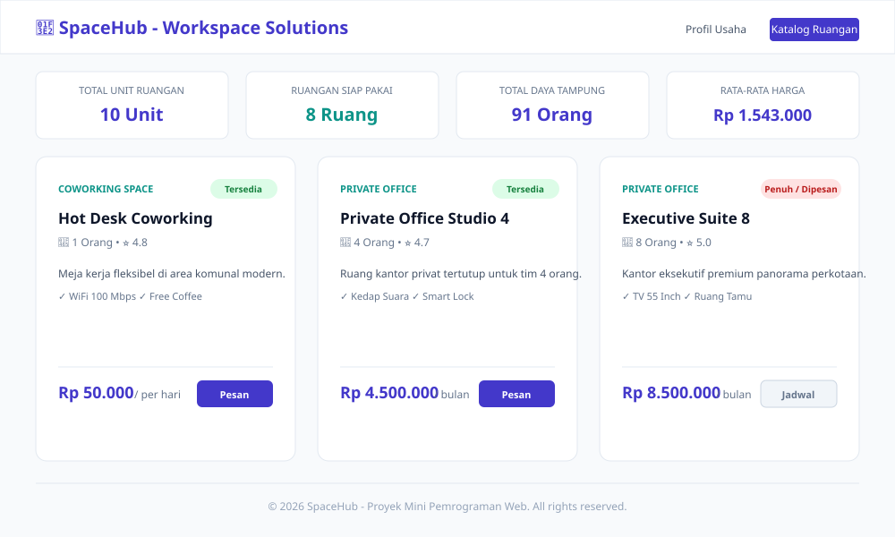

# UTS Pemrograman Web - Warung Makan Berkah

Proyek Mini Individu Website Profil & Katalog Dinamis Berbasis PHP Dasar.

---

## 1. Identitas Mahasiswa
- **Nama Lengkap** : [Nama Lengkap Anda]
- **NIM**          : [NIM Anda, contoh: 230101001]
- **Kelas**        : [Kelas Anda, contoh: TI-3A]
- **Mata Kuliah**  : Pemrograman Web (253A23W15)
- **Program Studi**: S1 Informatika, Fakultas Teknik, Tiga Serangkai University

---

## 2. Deskripsi Singkat Tema
Warung Makan Berkah adalah aplikasi web berbasis PHP dinamis untuk usaha kuliner UMKM. Website ini menyajikan informasi profil usaha, cerita komitmen, daftar menu favorit/unggulan, katalog menu lengkap (makanan utama, minuman, dan camilan), serta fitur pemesanan dan simulasi perhitungan total tagihan pembayaran secara transparan dan instan tanpa menggunakan database eksternal (menggunakan data array PHP).

---

## 3. Alur Website (USer Flow & Data Flow)
                       ┌─────────────────────────┐
                       │        Pengunjung       │
                       └────────────┬────────────┘
                                    │
           ┌────────────────────────┴────────────────────────┐
           ▼                                                 ▼
┌──────────────────────┐                          ┌──────────────────────┐
│      index.php       │                          │     katalog.php      │
│   (Profil Usaha)     │                          │  (Katalog & Pesan)   │
└──────────┬───────────┘                          └──────────┬───────────┘
           │                                                 │
           │  Mengambil Menu Unggulan                        │  Proses POST (Form Qty)
           ▼                                                 ▼
┌────────────────────────────────────────────────────────────────────────┐
│                             functions.php                              │
│  - getMenuUnggulan() -> Menyaring menu unggulan                        │
│  - formatRupiah()    -> Format harga Rp                                │
│  - e()               -> Sanitasi Output Anti-XSS                       │
└──────────────────────────────────┬─────────────────────────────────────┘
                                   │
                                   │  Membaca Master Data
                                   ▼
┌────────────────────────────────────────────────────────────────────────┐
│                                data.php                                │
│  $daftarMenu = [Array Multidimensi Menu Kuliner (ID, Nama, Harga, dll)]│
└────────────────────────────────────────────────────────────────────────┘


## 4. Cara Menjalankan di Localhost

Aplikasi ini tidak membutuhkan database (semua data tersimpan dalam array PHP) dan tidak menggunakan framework apa pun.

### Opsi A: Menggunakan PHP Built-in Server (Paling Cepat & Praktis)
1. Buka terminal (Command Prompt / PowerShell / Terminal VS Code).
2. Arahkan direktori aktif ke dalam folder proyek ini:
   ```bash
   cd path/ke/tema-1-warung-makan
   ```
3. Jalankan server lokal bawaan PHP:
   ```bash
   php -S localhost:8000
   ```
4. Buka browser dan akses URL:
   ```
   http://localhost:8000
   ```

### Opsi B: Menggunakan XAMPP
1. Salin (*copy*) folder `tema-1-warung-makan ke direktori `htdocs` XAMPP Anda:
   - Windows: `C:\xampp\htdocs\tema-1-warung-makan 
2. Jalankan modul **Apache** pada XAMPP Control Panel.
3. Buka browser dan buka:
   ```
   http://localhost/tema-1-warung-makan index.php
   ```

---

## 5. Daftar Fitur & Penanggung Jawab File/Fungsi

No | Fitur Utama               | File Terkait | Fungsi / Logika Penangan | Keterangan

1  |  Sanitasi Output Anti-XSS | functions.php |   e()                    | Mengamankan teks dari XSS dengan membungkus htmlspecialchars agar setiap teks yang dirender ke browser aman dari injeksi    script berbahaya.

2  | Format Mata Uang Rupiah   | functions.php | formatRupiah()           | Format angka ke format Rupiah (contoh: Rp 20.000).

3  | Filter Menu Unggulan      | functions.php, index.php | getMenuUnggulan() | Menyaring menu yang berstatus unggulan untuk di halaman profil (array_filter berdasarkan atribut unggulan === true).

4  | Render Otomatis Foreach   | katalog.php, index.php   | foreach ($daftarMenu as $item)   | Merender kartu item menu secara dinamis dari array utama tanpa penulisan HTML berulang.

5  | Kalkulasi Pesanan & Subtotal   | katalog.php  | foreach ($_POST['qty'] as $idMenu => $jumlahPorsi)  | Mengalkulasi subtotal porsi per item menu serta total akumulasi tagihan secara fleksibel.

6  | Pesan Kondisional Status Pesanan | katalog.php   | if ($adaPesanan) ... else   | Menampilkan rincian pesanan jika porsi diisi atau menampilkan peringatan jika belum memilih menu.
---

## 6. Daftar Fungsi Array Bawaan PHP yang Digunakan

No | Fungsi Bawaan Array   | Letak File:Baris   | Tujuan / Kegunaan dalam Proyek
1  | array_filter()        | functions.php      | Menyaring menu yang berstatus unggulan (unggulan === true) untuk ditampilkan di halaman profil usaha (index.php).

2  | foreach (Array Iteration)   | index.php, katalog.php   | Melakukan pemrosesan perulangan array untuk merender daftar menu unggulan, kartu katalog, dan rincian tagihan pesanan.

3  | isset() & empty() (Array Key Check)  | katalog.php  | Memeriksa keberadaan array $_POST['qty'] dan nilai input kuantitas porsi sebelum kalkulasi dilakukan.
---

## 7. Tangkapan Layar Aplikasi

> Letakkan gambar tangkapan layar di dalam folder `screenshots/` dengan nama file `screenshot-profil.svg` dan `screenshot-katalog.svg`.

1. **Tampilan Halaman Profil (`index.php`)**:
   
   *(Menampilkan navigasi semantik, hero banner ringkas, ringkasan statistik, profil singkat perusahaan, dan 3 fasilitas utama).*

2. **Tampilan Halaman Katalog (`katalog.php`)**:
   
   *(Menampilkan kartu statistik hitung PHP, render kartu item dengan foreach, dan badge status).*

---

## 8. Sumber Referensi & Catatan Pemakaian AI

### Sumber Referensi:
1. Dokumentasi Resmi PHP: [https://www.php.net/manual/en/](https://www.php.net/manual/en/) (Referensi `strict_types`, `array_filter`, `array_column`, `array_sum`, `usort`, `match expression`).
2. MDN Web Docs: [https://developer.mozilla.org/](https://developer.mozilla.org/) (Referensi elemen semantik HTML5 dan CSS Box Model).
3. Standar Penulisan Kode PHP PSR-12: [https://www.php-fig.org/psr/psr-12/](https://www.php-fig.org/psr/psr-12/).

### Catatan Pemakaian AI:
- **Bagian yang dibantu**:  AI digunakan untuk merancang variasi data dummy pada array multidimensi (data.php), diagram alur kerja ASCII, serta penyusunan format dokumentasi README ini.
- **Verifikasi Mandiri**: Seluruh logika PHP (declare(strict_types=1);, fungsi buatan sendiri bertipe, sanitasi e(), dan fungsi manipulasi array) telah diuji, dipahami, dan diverifikasi langsung melalui PHP CLI / Localhost untuk memastikan tidak ada error, warning, maupun notice. Mahasiswa memahami alur eksekusi baris per baris dan siap mendemokannya saat sesi ujian di hadapan dosen.

---

## Panduan Tambahan: 5 Langkah Commit Git Bertahap

Untuk memenuhi kriteria Git Level 4 (minimal 5 commit bertahap dengan pesan bermakna), ikuti langkah berikut di terminal:

```bash
# Inisialisasi git repository
git init

# Commit 1: Tahap 1 - Rancang tema dan struktur folder awal
git add README.md .gitignore
git commit -m "feat(init): inisialisasi struktur proyek dan dokumentasi awal tema layanan kerja"

# Commit 2: Tahap 2 - Kerangka HTML semantik dan stylesheet CSS murni
git add style.css assets/
git commit -m "feat(ui): rancang antarmuka semantik, tata letak CSS box model, dan aset grafis"

# Commit 3: Tahap 3 - Data array multidimensi dan fungsi pembantu bertipe
git add data.php functions.php
git commit -m "feat(core): implementasi data array multidimensi dan fungsi logika bertipe PSR-12"

# Commit 4: Tahap 3 - Render halaman dinamis dengan foreach dan ringkasan hitung
git add index.php katalog.php
git commit -m "feat(render): integrasi render halaman profil simpel dan katalog dinamis dengan foreach"

# Commit 5: Tahap 4 - Refaktor clean code dan kelengkapan dokumentasi
git add screenshots/ README.md
git commit -m "docs: lengkapi dokumentasi teknis, tangkapan layar, dan persiapan review kode"
```


